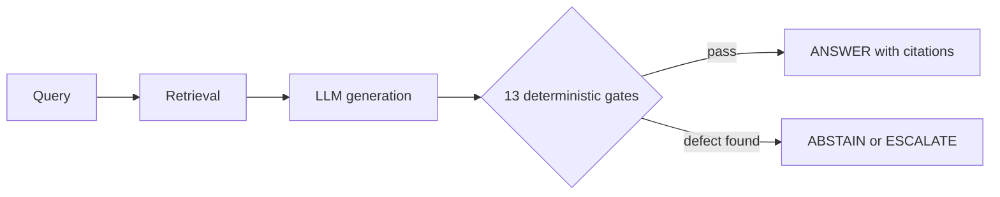

# Ammar Ayaz

**AI engineer building reliable language-model systems for regulated domains.**

Peshawar, Pakistan · [Email](mailto:ammarkhan9903233@gmail.com) · [LinkedIn](https://linkedin.com/in/ammarkhan-tech)

BS Computer Science, University of Engineering and Technology Peshawar (2022 to 2026), CGPA 3.43/4.00.
Applying to the MSc in Artificial Intelligence at Munster Technological University, September 2027 intake.

---

## About

I build retrieval-augmented generation (RAG) and agent systems, then measure how and when they fail. Language models become fluent long before they become reliable, and in a domain like financial compliance a confident wrong answer costs more than no answer.

My work asks how far deterministic checks (citation verification, contradiction detection, access control) and abstention can push a RAG system toward trustworthy behaviour. I test those claims with ablations and adversarial test suites, not demos, and I report the limits of each result next to the result.

## Research interests

- Selective prediction and abstention in retrieval-augmented generation
- Verifiable, citation-grounded generation for regulated domains
- Cross-lingual reliability: whether safety and compliance constraints survive in English and Arabic models
- Security of enterprise RAG: authorisation-aware retrieval and prompt-injection defence

---

## Featured research

### AAOIFI-RAG: verifiable RAG with selective prediction for Islamic finance compliance

Stage-1 research prototype · [Repository](https://github.com/ammarkhan081/AAOIFI-RAG)

**Question.** Can a deterministic verification layer stop a model from returning uncited or self-contradictory compliance answers, and does that protection hold across English and Arabic?

**Design.** 13 deterministic gates (10 enabled by default) check citation integrity, self-contradiction and script integrity, then route each generation to ANSWER, ABSTAIN or ESCALATE. The corpus is 5 AAOIFI standards with 362 clauses.

**Method.** A 2×2 ablation (Jais-2-8B and Qwen-2.5-7B, each with a basic and a strict prompt) over frozen retrieved contexts, so differences come from the generation layer and not from retrieval. Summary-augmented chunking raised mean clause Recall@5 from 0.571 to 0.750 (BM25) and from 0.643 to 0.833 (with reranking) on a 17-clause pilot set.

**Pilot findings (n = 7, descriptive).** Under a strict English prompt, Jais-2 emitted Arabic script inside English answers. Qwen-2.5 answered 2 questions, abstained on 4 and escalated 1, which the self-contradiction gate caught. No unsafe answer was served.

**Limits.** The gates measure mechanical safety (citations, consistency), not correctness. They cannot catch a fluent, correctly cited answer that is wrong, and n = 7 is a proof of concept, not a significant result. Next step: a larger evaluation set, and a test of whether gate decisions predict real errors.

---

## Projects

### [VERITAS-lite: security testing for AI agents](https://github.com/ammarkhan081/VERITAS-lite)

Pak Angels Final Hackathon, October 2026 · Team leader of 4 · [Live demo](https://veritas-lite.vercel.app) · MIT licence

A closed-loop, multi-agent system that attacks a system under test, verifies its behaviour with deterministic gates, proposes a defence, and then re-tests both attack resistance and normal-task utility.

- A Red Team generates attacks (prompt injection, goal hijacking), a Verifier checks for violated constraints, and a Blue Team proposes a patch that is checked against regression and held-out tests.
- Runs offline with a deterministic demo; the pytest suite uses mocked agents and isolated SQLite databases.
- The README lists its limits, including that the AgentDojo adapter is still a stub.

`LangGraph` `FastAPI` `SQLite` `React` `Docker`

### [Secure Role-Based AI Assistant for Enterprise Finance](https://github.com/ammarkhan081/RBAC-Project)

Pak Angels Cohort 11 Mid-Term Hackathon, September 2026 · Team leader of 6 · MIT licence

An assistant where access control is enforced before the model sees any data.

- Generated SQL is parsed into a syntax tree (`sqlglot`) and checked against role-permitted, column-masked views before execution.
- A dual-gate sanitiser screens for prompt injection, and an audit ledger records every query and every blocked attempt.
- A three-way router (SQL, RAG, hybrid) returns answers with citations to the underlying views or document sections.
- In our own 42-vector red-team suite, all 42 attacks were blocked, with 0.0% cross-role leakage, and 93 automated tests pass. These are self-written tests, so they are a baseline and not proof of security.

`FastAPI` `DuckDB` `sqlglot` `FastEmbed` `FlashRank` `Next.js`

### [AI Research Analyst: agentic corrective RAG](https://github.com/ammarkhan081/ai-research-analyst)

A cyclic LangGraph agent that answers questions over a private corpus and grades its own evidence.

- A router chooses between answering directly, retrieving, and web search. Retrieved documents are graded (CRAG), and a Self-RAG check forces regeneration when an answer is not grounded.
- Hybrid retrieval: BM25 and dense BGE embeddings fused with reciprocal rank fusion, then cross-encoder reranking.
- Every request produces a redacted, structured step trace. Tools are also exposed through an MCP server.

`LangGraph` `ChromaDB` `BGE` `Tavily` `MCP` `RAGAS` `FastAPI`

### [Sovereign On-Premises Finance Assistant](https://github.com/ammarkhan081/Finance-Sovereign-Assistant)

A finance assistant that makes no external API calls.

- Mistral 7B fine-tuned with QLoRA (Unsloth, LoRA rank 16) on about 2,850 filtered finance instruction pairs, served locally through Ollama.
- Four-stage hybrid retrieval: BM25, dense BGE, reciprocal rank fusion and cross-encoder reranking.
- The comparison against the base model has not been run yet, so I make no claim about the fine-tune's benefit.

`QLoRA` `Unsloth` `Ollama` `Mistral 7B` `FAISS`

Also: [ASHIA](https://github.com/ammarkhan081/Agentic-AIOps-Platform-Self-Healing-Infrastructure-Agent), a six-agent LangGraph pipeline that detects infrastructure anomalies (Z-score over 12 Prometheus metrics), diagnoses them from logs, traces and incident memory, and sends medium and high-risk fixes to a human for approval.

---

## Experience and training

**AI Automation Engineer (Internship), MorpheLabs** · Remote · 29 January to 16 June 2026

- Built the cognition layer of a WhatsApp AI agent for voice and text: 10 orchestrated workflows with Google Calendar, Gmail and long-term semantic memory in Supabase (pgvector).
- Built a multi-source lead-generation pipeline in n8n, including LinkedIn scraping for job-posting extraction and competitor monitoring.
- Built a content management system (Node.js, Express, PostgreSQL, Prisma, Next.js) with JWT authentication and role-based access control.

**Generative and Agentic AI Application Developer Certificate, Pak Angels** · Cohort 11, August to October 2026 · Top Performer · Certificate ID PAGAI-TP-0417

---

## Technical skills

- **Languages:** Python, TypeScript, SQL
- **LLMs and NLP:** PyTorch, Hugging Face Transformers, QLoRA/LoRA fine-tuning, prompt engineering, RAGAS
- **Agents and retrieval:** LangGraph, MCP, hybrid retrieval (BM25 and dense, RRF), cross-encoder reranking, CRAG and Self-RAG
- **Data stores:** ChromaDB, FAISS, DuckDB, SQLite, Supabase (pgvector)
- **Engineering:** FastAPI, Next.js, Docker Compose, n8n

---

## Contact

[ammarkhan9903233@gmail.com](mailto:ammarkhan9903233@gmail.com) · [LinkedIn](https://linkedin.com/in/ammarkhan-tech)
